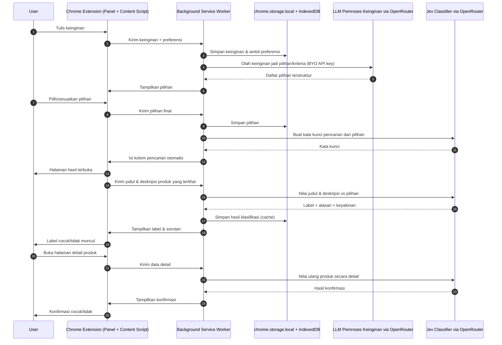
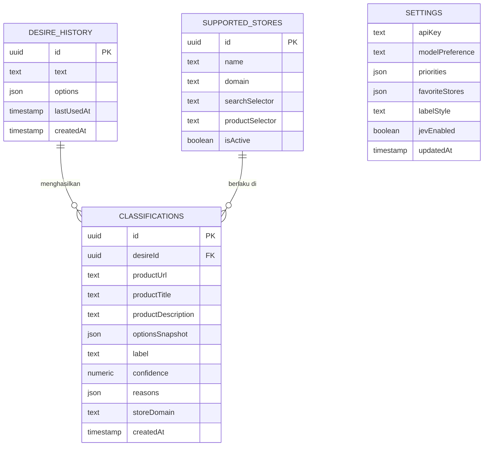

# PRD — Project Requirements Document

## 1. Overview

**Masalah yang diselesaikan**
Saat ini, mencari produk yang benar-benar sesuai keinginan di toko online seperti Tokopedia atau Shopee sangat melelahkan. User harus menulis kata kunci manual, membuka satu per satu halaman produk, lalu membaca deskripsi panjang untuk menilai apakah produk itu cocok. Proses ini memakan waktu, membingungkan, dan sering berujung pada keputusan yang kurang tepat.

**Tujuan utama aplikasi**
Membuat sebuah **Chrome Extension** yang membantu user menemukan produk yang cocok tanpa harus berpikir manual. User cukup menulis keinginannya dalam bahasa sehari-hari, lalu extension akan:
- Mengisi kolom pencarian di toko online secara otomatis.
- Menandai setiap produk di halaman hasil dengan label **Cocok** atau **Tidak Cocok**.
- Menegaskan kembali kecocokan produk saat halaman detail dibuka.
- Menjelaskan alasan penilaian dengan bahasa sederhana.

Semua penilaian dilakukan oleh model classifier bernama **Jev**, yang disesuaikan dengan preferensi dan prompt pribadi user.

**Kemenangan pertama user**
User menulis keinginannya dan langsung melihat produk mana yang cocok — tanpa perlu membaca deskripsi satu per satu.

---

## 2. Requirements

- **Platform:** Chrome Extension (Manifest V3) yang bisa dipasang di browser desktop.
- **Dukungan Toko:** Minimal bekerja di Tokopedia dan Shopee, dengan struktur yang mudah ditambah toko lain.
- **Input User:** Kolom untuk menulis keinginan dalam bahasa natural (contoh: "sepatu lari ringan di bawah 500 ribu").
- **Otomatisasi Pencarian:** Extension dapat mengenali kolom pencarian di toko online dan mengisinya secara otomatis.
- **Pengolahan Keinginan (LLM):** Keinginan user dalam bahasa natural diolah oleh LLM menjadi daftar **pilihan/kriteria terstruktur** (mis. kategori, rentang harga, atribut wajib, atribut opsional) yang dipakai sebagai acuan klasifikasi.
- **Model Classifier "Jev":** Memberi label **Cocok / Tidak Cocok** pada tiap produk berdasarkan **judul dan deskripsi produk**, dinilai terhadap pilihan/kriteria hasil pengolahan keinginan (dikonfirmasi dengan elemen lain seperti harga, gambar, rating bila tersedia).
- **Personalisasi:** Penilaian mengikuti preferensi user (prioritas harga, kualitas, pengiriman, toko favorit).
- **Visual Label:** Label warna dan sorotan agar produk yang cocok mudah terlihat.
- **Penjelasan Sederhana:** Setiap label disertai alasan singkat tanpa istilah teknis.
- **Data Tersimpan:** Riwayat keinginan dan preferensi user tersimpan agar bisa dipakai ulang.
- **API Key User (BYO Key):** User memasukkan sendiri API key OpenRouter miliknya. Key disimpan lokal di browser dan hanya dipakai untuk memanggil model; tidak ada server perantara.
- **Privasi:** Keinginan dan data produk diproses di dalam browser. Data hanya dikirim ke OpenRouter memakai API key user sendiri untuk keperluan klasifikasi — tidak ada backend milik pengembang yang menyimpan data.
- **Performa:** Hasil label muncul dalam beberapa detik setelah halaman produk dimuat.

---

## 3. Core Features

### Fase 1 — Dasar Pengalaman Mencari
- **Panel Keinginan** — Tempat menulis keinginan dan memulai pencarian produk.
  - Tulis Keinginan: Mengetik apa yang sedang dicari dalam bahasa sehari-hari.
  - Contoh Keinginan: Melihat contoh kalimat agar lebih mudah menulis keinginan.
  - Mulai Pencarian: Menjalankan pencarian berdasarkan keinginan yang sudah ditulis.
  - Ganti Keinginan: Mengubah atau menghapus keinginan lalu mencari ulang.
- **Pemahaman Keinginan** — Mengubah keinginan bebas menjadi pilihan/kriteria terstruktur dengan bantuan LLM, sebelum produk dinilai.
  - Olah Keinginan: LLM membaca keinginan user dan mengekstrak maksud utamanya.
  - Daftar Pilihan: Menghasilkan beberapa pilihan/kriteria (mis. kategori produk, rentang harga, ukuran, bahan, atribut wajib) sebagai acuan penilaian.
  - Pilih & Sesuaikan: User bisa melihat, memilih, atau mengedit pilihan sebelum pencarian dijalankan.
  - Acuan Klasifikasi: Pilihan yang dipakai dikirim ke Jev sebagai dasar penilaian judul & deskripsi produk.
- **Label Etalase** — Menandai produk di halaman hasil dengan label cocok atau tidak.
  - Label Cocok/Tidak: Memberi tanda jelas pada tiap produk yang sesuai atau tidak.
  - Sorotan Warna: Membuat produk yang cocok lebih mudah terlihat.
  - Ringkasan Singkat: Menampilkan alasan singkat di dekat label.
  - Urutkan yang Cocok: Menyusun produk agar yang paling cocok muncul lebih dulu.
- **Cari Otomatis** — Mengisi kolom pencarian di toko online dengan keinginan user.
  - Deteksi Kolom Cari: Mengenali kotak pencarian di halaman toko online.
  - Isi & Cari: Menuliskan keinginan ke kolom pencarian dan menjalankannya.
  - Dukungan Toko: Bekerja di beberapa toko online populer seperti Tokopedia dan Shopee.
  - Ganti Toko: Berpindah toko tanpa menulis ulang keinginan.
- **Kendali Jev** — Menyalakan atau mematikan Jev sesuai keinginan user.
  - Switch On/Off: Tombol sederhana di panel untuk mengaktifkan atau menonaktifkan Jev.
  - Status Tersimpan: Pilihan on/off tetap tersimpan setelah extension ditutup dan dibuka kembali.
  - Hormati Saat Nonaktif: Saat Jev nonaktif, extension berhenti mengirim data produk dan tidak lagi menyuntikkan label, tanpa menghapus data yang sudah ada.
- **Pengaturan API Key** — Menyimpan API key OpenRouter milik user agar extension bisa memanggil model.
  - Input API Key: User menempelkan API key OpenRouter miliknya di panel pengaturan.
  - Simpan Lokal: Key disimpan di penyimpanan lokal browser, tidak pernah dikirim ke server mana pun selain OpenRouter.
  - Uji Koneksi: Memastikan key valid dan model bisa diakses sebelum dipakai.
  - Ganti/Hapus Key: Mengganti atau menghapus key kapan saja; bila kosong, fitur AI dinonaktifkan dengan pesan yang jelas.

### Fase 2 — Kedalaman Penilaian
- **Konfirmasi Detail** — Menegaskan kecocokan produk saat halaman detail dibuka.
  - Cek Ulang Produk: Menilai ulang produk yang sedang dilihat secara lebih detail.
  - Label di Halaman Detail: Menampilkan tanda cocok atau tidak di halaman produk.
  - Alasan di Detail: Menjelaskan kenapa produk dinilai cocok atau tidak.
  - Bandingkan dengan Keinginan: Menunjukkan bagian keinginan yang sudah terpenuhi.
- **Penjelasan Jev** — Memberi alasan sederhana kenapa Jev menilai produk cocok atau tidak.
  - Poin Alasan: Menampilkan beberapa alasan utama penilaian.
  - Sorot Elemen Penting: Menandai bagian produk yang paling memengaruhi penilaian.
  - Bahasa Sederhana: Menyampaikan alasan tanpa istilah teknis.
  - Tingkat Keyakinan: Menunjukkan seberapa yakin Jev dengan penilaiannya.

### Fase 3 — Personalisasi & Riwayat
- **Riwayat Keinginan** — Menyimpan daftar keinginan agar bisa dipakai lagi kapan saja.
  - Simpan Otomatis: Menyimpan keinginan yang pernah dicari.
  - Pakai Ulang: Menjalankan kembali keinginan lama dengan sekali klik.
  - Kelola Riwayat: Menghapus atau merapikan daftar keinginan lama.
  - Cari di Riwayat: Menemukan keinginan lama dengan cepat.
- **Preferensi Saya** — Mengatur selera dan cara Jev menilai produk untuk user.
  - Atur Prioritas: Memilih hal yang paling penting seperti harga, kualitas, atau pengiriman.
  - Toko Favorit: Menentukan toko online yang sering dipakai.
  - Tampilan Label: Mengatur bentuk dan warna label agar mudah dilihat.
  - Reset Preferensi: Mengembalikan pengaturan ke awal.

### Fase 4 — Bantuan & Onboarding
- **Panduan Pakai** — Memberi petunjuk singkat saat user bingung memakai extension.
  - Tur Pertama: Memandu user baru mencoba alur utama dari awal.
  - Tips Cepat: Menampilkan saran singkat saat memakai fitur.
  - Tanya Jawab: Menjawab pertanyaan umum tentang cara pakai.
  - Hubungi Bantuan: Memberi cara menghubungi bantuan bila ada masalah.

---

## 4. User Flow

**Alur Utama — Mencari dari Halaman Etalase**
1. User membuka Chrome dan mengklik ikon extension Jev.
2. Panel Keinginan terbuka. User menulis keinginannya (contoh: "sepatu lari ringan di bawah 500 ribu").
3. User menekan **Mulai Pencarian**.
4. **Pemahaman Keinginan** mengolah keinginan tersebut menjadi daftar pilihan/kriteria (mis. kategori "sepatu lari", harga ≤ 500.000, ringan). User bisa menyesuaikan pilihan ini.
5. Extension membuka toko online pilihan (mis. Tokopedia), lalu mengisi kolom pencarian secara otomatis.
6. Halaman hasil muncul. Jev menilai **judul & deskripsi** tiap produk terhadap pilihan/kriteria tadi, lalu memberi label **Cocok / Tidak Cocok**.
7. Produk yang cocok diberi sorotan warna + alasan singkat. User bisa menekan **Urutkan yang Cocok**.
8. User membuka salah satu halaman detail produk.
9. Jev melakukan **Cek Ulang** dan menampilkan label, alasan, serta bagian keinginan/pilihan yang sudah terpenuhi.
10. Keinginan dan pilihan tersimpan ke **Riwayat** untuk pencarian berikutnya.

**Alur Mengolah Keinginan menjadi Pilihan**
1. User menulis keinginan bebas di panel (contoh: "tas kerja anti air buat laptop 14 inci, budget 300 ribuan").
2. LLM mengubahnya menjadi beberapa pilihan/kriteria terstruktur, mis. kategori "tas laptop", kapasitas "≥14 inci", sifat "anti air", harga maksimum "≈300.000".
3. User meninjau, memilih, atau mengedit pilihan tersebut.
4. Pilihan yang dipakai menjadi acuan saat Jev menilai judul & deskripsi produk di halaman hasil.

**Alur Menyiapkan API Key**
1. Saat extension pertama kali dipasang, user diminta memasukkan API key OpenRouter miliknya.
2. Extension menguji koneksi ke model; bila gagal, ditampilkan pesan yang jelas.
3. Key disimpan lokal di browser dan dipakai untuk semua panggilan AI berikutnya.

**Alur Pengaturan Preferensi**
1. User membuka menu **Preferensi Saya**.
2. User menentukan prioritas (harga, kualitas, pengiriman) dan toko favorit.
3. Jev menyesuaikan cara memberi label sesuai preferensi tersebut.

**Alur Menonaktifkan Jev**
1. User membuka panel extension dan melihat switch **Kendali Jev**.
2. User mematikan switch tersebut.
3. Extension berhenti menilai produk dan menyuntikkan label pada halaman toko; saat switch dinyalakan lagi, Jev kembali bekerja dengan preferensi yang sama.

**Alur User Baru**
1. Saat extension dipasang pertama kali, **Tur Pertama** muncul.
2. User dipandu menulis keinginan hingga melihat label pertama.
3. Jika bingung, user bisa membuka **Tips Cepat** atau **Tanya Jawab**.

---

## 5. Architecture

Extension Jev terdiri dari dua lapisan utama — **tanpa server backend**:

- **Lapisan Browser (Chrome Extension):** popup untuk Panel Keinginan, content script untuk membaca elemen halaman & menyuntikkan label, dan background service worker yang menjadi otak penghubung. Service worker inilah yang memanggil AI dan mengelola penyimpanan lokal.
- **Lapisan AI (dua peran, lewat OpenRouter API):**
  - **Pemroses Keinginan (LLM):** menerima keinginan bebas user dan mengubahnya menjadi daftar **pilihan/kriteria terstruktur** (kategori, harga, atribut wajib/opsional) yang bisa ditinjau dan diedit user.
  - **Jev Classifier:** menerima pilihan/kriteria + **judul & deskripsi produk**, lalu mengembalikan label, alasan, dan tingkat keyakinan.

Panggilan ke OpenRouter dilakukan **langsung dari background service worker** memakai API key milik user (BYO key) yang disimpan lokal di `chrome.storage.local`. Tidak ada server Express, tidak ada database server. Karena service worker berjalan di konteks extension, panggilan tidak terpengaruh CSP/CORS halaman toko.

**Penyimpanan lokal:** preferensi, riwayat keinginan, konfigurasi toko, cache hasil klasifikasi, dan API key disimpan di `chrome.storage.local` (data kecil seperti preferensi & key) dan **IndexedDB** (data lebih besar seperti riwayat & cache klasifikasi).

---

## 6. Data Storage (Lokal di Browser)

Tidak ada database server. Semua data tersimpan **lokal di browser** memakai `chrome.storage.local` (data kecil) dan **IndexedDB** (data lebih besar). Struktur data (store) utama:

- **settings** — Preferensi & konfigurasi extension (di `chrome.storage.local`).
  - `apiKey` (Text, API key OpenRouter milik user — disimpan lokal, tidak pernah dikirim ke server selain OpenRouter)
  - `modelPreference` (Text, model OpenRouter yang dipakai untuk pemroses keinginan & Jev)
  - `priorities` (JSON, prioritas seperti harga/kualitas/pengiriman)
  - `favoriteStores` (JSON, daftar toko favorit)
  - `labelStyle` (Text, gaya & warna label)
  - `jevEnabled` (Boolean, status aktif/nonaktif Jev; default true)
  - `updatedAt` (Timestamp)

- **desireHistory** — Riwayat keinginan (di IndexedDB).
  - `id` (UUID, kunci utama)
  - `text` (Text, isi keinginan)
  - `options` (JSON, daftar pilihan/kriteria hasil olahan LLM atas keinginan)
  - `lastUsedAt` (Timestamp, terakhir dipakai)
  - `createdAt` (Timestamp)

- **classifications** — Cache hasil penilaian Jev agar tidak perlu diulang (di IndexedDB).
  - `id` (UUID, kunci utama)
  - `desireId` (UUID, relasi ke desireHistory)
  - `productUrl` (Text, tautan produk)
  - `productTitle` (Text, judul produk)
  - `productDescription` (Text, deskripsi produk yang dipakai untuk penilaian)
  - `optionsSnapshot` (JSON, pilihan/kriteria yang dipakai saat penilaian)
  - `label` (Text, "cocok" / "tidak_cocok")
  - `confidence` (Numeric, tingkat keyakinan 0–1)
  - `reasons` (JSON, poin-poin alasan dari Jev)
  - `storeDomain` (Text, domain toko)
  - `createdAt` (Timestamp)

- **supportedStores** — Daftar toko online yang didukung (dibundel bersama extension sebagai konfigurasi, dapat diperbarui lewat pembaruan extension).
  - `id` (UUID, kunci utama)
  - `name` (Text, nama toko)
  - `domain` (Text, domain toko)
  - `searchSelector` (Text, cara mengenali kolom pencarian)
  - `productSelector` (Text, cara mengenali elemen produk)
  - `isActive` (Boolean, status aktif)

---

## 7. Tech Stack

- **Chrome Extension (Frontend):** React + TypeScript + Vite, dibungkus dengan **Manifest V3** untuk popup panel, content script (penyuntik label), dan background service worker. Styling memakai **Tailwind CSS** + **shadcn/ui** agar tampilan label dan panel konsisten dan cepat dibuat.
- **AI Provider / Gateway:** **OpenRouter API**, dipanggil **langsung dari background service worker** extension melalui HTTPS. Tidak ada server perantara.
  - Autentikasi memakai **API key milik user (BYO key)** yang dimasukkan lewat panel Pengaturan API Key dan disimpan di `chrome.storage.local`.
  - `host_permissions` extension menyertakan domain OpenRouter agar service worker dapat memanggil API.
  - Dua peran model: **(1) LLM Pemroses Keinginan** — mengubah input utama user menjadi pilihan/kriteria terstruktur; **(2) Jev Classifier** — menilai "Cocok / Tidak Cocok" atas **judul & deskripsi produk** terhadap pilihan tersebut, serta menyusun kata kunci pencarian dan alasan sederhana.
- **Penyimpanan Data:** **Lokal di browser** — `chrome.storage.local` untuk preferensi, konfigurasi, dan API key; **IndexedDB** untuk riwayat keinginan dan cache klasifikasi. Tidak ada database server.
- **Deployment:**
  - **Extension** — dipublikasikan ke Chrome Web Store. Seluruh logika (UI, panggilan AI, penyimpanan) berjalan di sisi client.

**Catatan stack:**
- **Tidak ada backend Express.js dan tidak ada PostgreSQL.** Keduanya dibuang dari lingkup; seluruh pemrosesan dilakukan di browser extension.
- Tidak ada autentikasi/login. Karena data hanya tersimpan lokal, tidak diperlukan `client_id` maupun tabel user.
- InsForge, Next.js, Drizzle ORM, SQLite, dan Better Auth tidak dipakai.
- Konsekuensi yang disadari: (a) data tidak tersinkron antar perangkat, (b) biaya token AI ditanggung user lewat key masing-masing, (c) bila ke depan butuh sinkronisasi lintas perangkat, kuota terpusat, atau update konfigurasi toko tanpa rilis ulang, barulah server (mis. proxy tipis Express) perlu ditambahkan kembali.